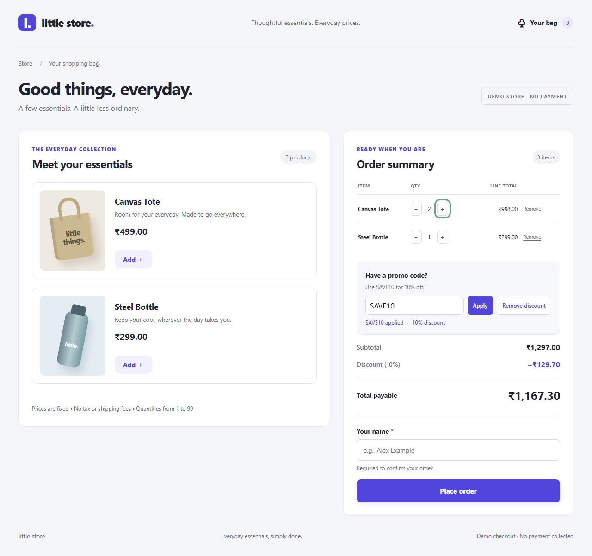
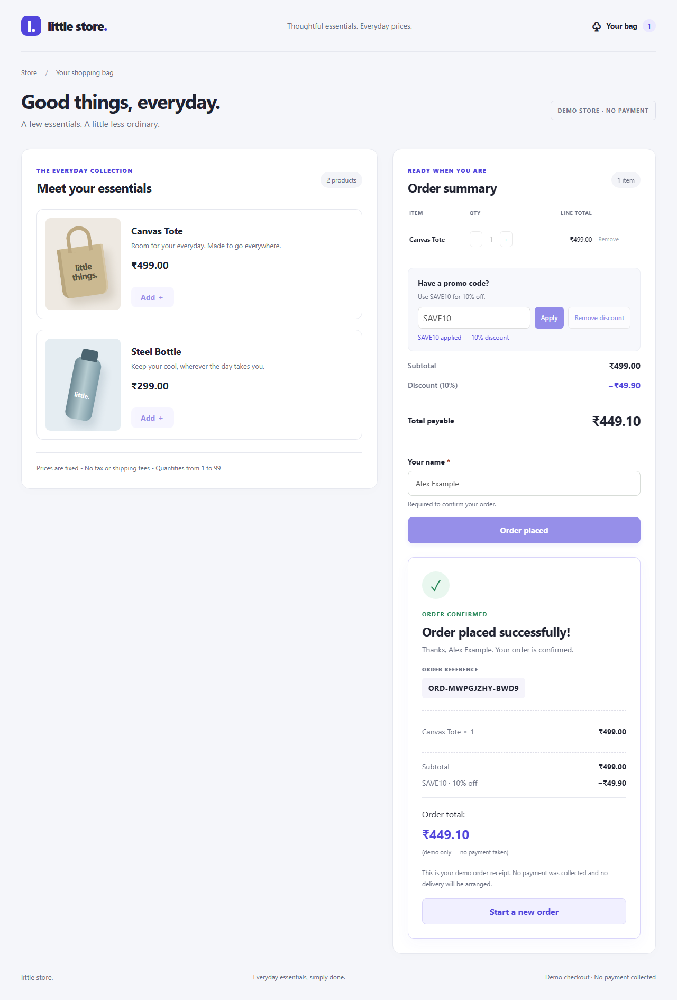

<div align="center">

# little store.
### Mini Checkout & Browser Test Suite

**FyndHacks · SDET Intern Challenge · Round 1**

A friendly two-product checkout, built to be **easy to use** and **thoroughly testable**.


[**Run it locally**](#-quick-start) · [**Explore test coverage**](#-automated-testing) · [**See evidence**](#-test-results--evidence) · [**Defect report**](#-defect-investigation)

</div>

---

## ✨ See the checkout

<p align="center"></p>

| Product selection and exact totals | Discounted receipt |
|:--:|:--:|
|  |  |

**More screenshots:** [Validation](docs/media/showcase-validation.png) · [Empty-cart protection](docs/media/showcase-empty-cart.png) · [Mobile viewport](docs/media/showcase-mobile.png) · [Full screenshot gallery](docs/SCREENSHOT_GALLERY.md)

## 🎯 The challenge

A small store needs accurate checkout totals, actionable validation, and a **single, clear order confirmation**. This project pairs the UI with repeatable browser automation and evidence, rather than relying on clicks without assertions.

**Application behaviour**

- Two synthetic products: **Canvas Tote — ₹499.00** and **Steel Bottle — ₹299.00**.
- Add/remove items, edit quantities from **1–99**, and see exact line totals, cart count, subtotal and payable amount.
- Apply `SAVE10` for **10% off**, without stacking; remove the promotion or change quantities and see totals recalculate.
- Block empty-cart and missing/whitespace-only name submissions while preserving entered information.
- Create an in-page order receipt with itemized amounts and a locally generated reference; prevent duplicate submission in the same page session.
- Restart with **Start a new order**. No API, database, account or real payment is involved.

### Example arithmetic

| Item | Quantity | Amount |
|:---|---:|---:|
| Canvas Tote | 2 | ₹998.00 |
| Steel Bottle | 1 | ₹299.00 |
| **Subtotal** | | **₹1,297.00** |
| `SAVE10` (10%) | | −₹129.70 |
| **Total payable** | | **₹1,167.30** |

## 🚀 Quick start

### 1. Launch the website

**Windows:** double-click `start.bat`. It opens `index.html` in your default browser. `run_app.bat` is an alias.

**Any operating system (localhost URL):**

```bash
python run.py
```

The command chooses an available localhost port and opens the site. Press **Ctrl+C** to stop. Use `py -3` on Windows or `python3` on macOS/Linux if needed.

### 2. Run all browser tests

**Windows:** double-click `test.bat` or `run_tests.bat`. The command window stays open so you can see results. The first run installs dependencies and Chromium automatically (internet is required for downloads).

**Any operating system:**

```bash
python run.py test
```

The test runner starts its **own temporary HTTP server** and gives each test a **new browser context**. You do **not** need to launch the website first.

**Helpful commands**

```bash
python run.py test --headed                # Visible Chromium browser
python run.py test -k T14                 # Select tests by keyword
python run.py serve --port 8000           # Serve on a fixed local port
```

To prepare dependencies without executing tests on Windows, double-click `setup.bat`.

### 3. Optional: run Firefox / WebKit

After initial setup, install the engines:

```bash
.venv/Scripts/python.exe -m playwright install firefox webkit
python run.py test --engine firefox
python run.py test --engine webkit
```

On macOS/Linux, replace `.venv/Scripts/python.exe` with `.venv/bin/python`. Browser engines may require additional system libraries on Linux; GitHub Actions installs their dependencies in its runner.

## 🧪 Automated testing

The source suite contains **59 pytest executions** (including parameterized discount cases) organized by behaviour, not by page markup. It covers the five core scenarios and additional risks.

| Test module | Core risks |
|:---|:---|
| [`test_checkout.py`](tests/test_checkout.py) | **T01–T05:** order success, missing name, exact quantity pricing, empty cart, duplicate submit |
| [`test_cart.py`](tests/test_cart.py) | Add, remove, re-add, item counts, quantity boundaries, currency formatting |
| [`test_discounts.py`](tests/test_discounts.py) | `SAVE10` case variants, invalid code, no stacking, removal, recalculation, receipt/reset |
| [`test_validation.py`](tests/test_validation.py) | Blank/whitespace names, retained cart, safe name rendering |
| [`test_order_safety.py`](tests/test_order_safety.py) | Receipt contents, one order reference, post-submit editing locks, Enter submission |
| [`test_browser.py`](tests/test_browser.py) | Refresh, isolated contexts, keyboard focus, mobile width, JS console, error semantics |

**Testing approach:** Playwright retrying assertions target visible text and accessible controls. Fixtures manage the local server, isolated contexts, failure screenshots and traces. No fixed sleep delays are needed for correctness checks.

See the [prioritized test plan](TEST_PLAN.md), [test case catalog](TEST_CASES.md) and [traceability matrix](TRACEABILITY_MATRIX.md).

## 📊 Test results & evidence

**Results recorded in the uploaded project**, sourced from its saved JUnit XML reports on **21 November 2026** (Windows 11, Python 3.13.5, Playwright 1.57.0). These are archived run results, **not a fresh GitHub Actions execution or a new run performed during README preparation**.

| Run | Pass | Fail | Error | Skip | Saved report |
|:---|---:|---:|---:|---:|:---|
| Chromium | **59** | 0 | 0 | 0 | [XML](evidence/chromium-current.xml) · [HTML](evidence/chromium-current.html) |
| Firefox | **59** | 0 | 0 | 0 | [XML](evidence/firefox-current.xml) · [HTML](evidence/firefox-current.html) |
| WebKit | **59** | 0 | 0 | 0 | [XML](evidence/webkit-current.xml) · [HTML](evidence/webkit-current.html) |
| Chromium repeat (T48) | **59** | 0 | 0 | 0 | [XML](junit-results.xml) · [HTML](test-report.html) |

The full Chromium run was repeated to check consistency. [Detailed results](TEST_RESULTS.md) include durations, environment and limits. Engine-specific screenshots are preserved under [`evidence/chromium/`](evidence/chromium/), [`evidence/firefox/`](evidence/firefox/) and [`evidence/webkit/`](evidence/webkit/). Download an HTML report and open it locally if GitHub displays its raw source.

> **Manual testing is still pending.** The organizer requires **human execution** of empty-cart checkout (T04) and a **physical rapid double-click** (T05). Both automated versions passed; those results do not replace human observations. Fill the [manual test log](MANUAL_TEST_LOG.md) with actual outcomes and evidence before submission.

## 🐞 Defect investigation

**BUG-001 — WebKit skipped the bag navigation link during Tab navigation.**

- **Original observation:** T43 failed in the [historical WebKit XML](evidence/webkit-run1.xml) (1 failure in 47 tests).
- **Expected:** keyboard focus moves from the logo to **Your bag**.
- **Fix recorded in the source:** explicit `tabindex="0"` on both navigation links.
- **Verification:** [targeted T43 pass](evidence/webkit-focus.xml), followed by [59/59 passing in WebKit](evidence/webkit-current.xml).

See the complete [defect report](DEFECT_REPORT.md). This is a documented application issue, not an invented defect. A separate historical test-harness teardown error is explicitly distinguished from application defects in the reports.

## 📁 Repository guide

```text
.
├── index.html / styles.css / app.js   # Dependency-free checkout
├── start.bat / run_app.bat            # Windows app launchers
├── test.bat / run_tests.bat           # Windows test launchers
├── setup.bat / run.py                 # Environment + server + runner
├── requirements.txt / pytest.ini
├── tests/                             # Browser tests and shared fixtures
├── evidence/                          # Recorded screenshots and reports
│   ├── chromium/  firefox/  webkit/
│   ├── *-current.html / *-current.xml
│   └── 01-*.png … 05-*.png
├── docs/
│   ├── media/                        # Curated screenshots displayed here
│   └── SCREENSHOT_GALLERY.md
├── .github/workflows/browser-tests.yml # Optional CI definition
├── README.md / TEST_PLAN.md / TEST_CASES.md
├── TEST_RESULTS.md / TRACEABILITY_MATRIX.md
├── MANUAL_TEST_LOG.md / DEFECT_REPORT.md
└── VIDEO_WALKTHROUGH.md
```

`.venv/`, test caches and compiled Python files are **not included** in this repository. The original upload contains them, but they are machine-specific, bulky and should not be committed.

## ⚙️ GitHub Actions

A workflow is included in [`.github/workflows/browser-tests.yml`](.github/workflows/browser-tests.yml) to run browser tests on a push or pull request and retain reports. It is **configured, not claimed to have run**; GitHub status is available only after publishing and running the workflow.

## 🧭 Assumptions, gaps and submission steps

- **Scope:** synthetic products, browser-only, in-memory cart/order, no persistence, API, payments, delivery or server-side idempotency.
- **Browser claim:** Playwright Chromium, Firefox and WebKit engines; not certification of native Safari, Chrome versions or physical mobile devices.
- **Accessibility claim:** selected keyboard, labeling and error-state checks, not a complete screen-reader audit.
- **Privacy:** saved test reports have the original local hostname replaced by `LOCAL-WINDOWS-HOST` for publication; all test counts and assertion outcomes are unchanged.
- **Still required from participant:** execute and document two manual checks; verify the current project locally; record and upload a 7–10-minute **Unlisted YouTube** explanation; confirm **Submitted** in FyndHacks within the personal deadline.

Read the [recording outline](VIDEO_WALKTHROUGH.md) and [manual log](MANUAL_TEST_LOG.md) before final submission.

---

<div align="center"><strong>Built for accurate results, reproducible tests, and clear evidence.</strong><br><sub>Demo-only storefront — no purchases or personal information are processed.</sub></div>
